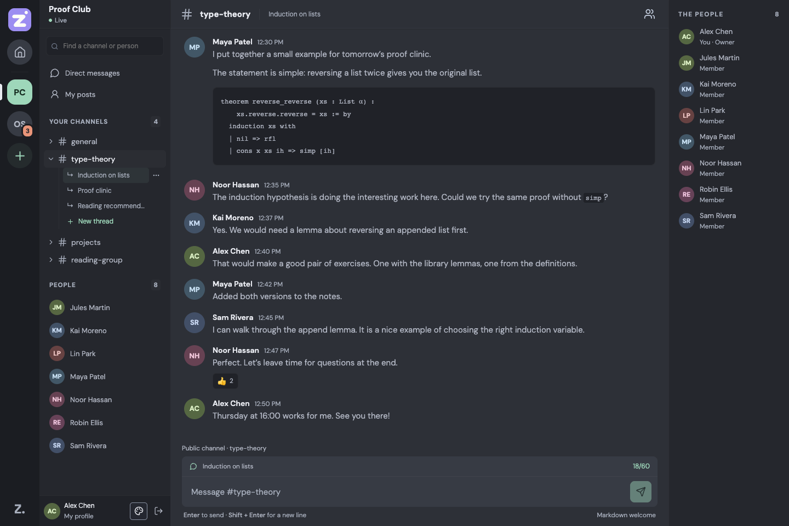

<p align="center"></p>
<h1 align="center">Zoomerlip</h1>

A [Zulip](https://github.com/zulip/zulip) client suitable for zoomers.

[](docs/screenshots/channels.png)

[](docs/screenshots/appearance.png)

[Website](https://zoomerlip.kirancodes.me) · [Source](https://github.com/kiranandcode/zoomerlip)

## Setup

Requires Node.js 22.12+.

```sh
npm ci
npm run dev
```

Open <http://127.0.0.1:5173>.

Sign in with your organisation URL, email and password, or paste an API key for SSO.

The client calls each organisation directly over HTTPS. The organisation must allow CORS requests with an Authorization header.

API keys stay in browser storage; the client discards passwords after login.

Custom palettes stay on your device.

## Build and test

```sh
npm test
npm run build       # static files in dist/
npm run preview
export ZOOMERLIP_TEST_URL=http://127.0.0.1:4173
npm run test:ui
npm run test:themes
npm run test:safety
npm run test:scale
npm run test:messaging
npm run test:organisation
npm run test:notifications
```

Browser tests use Chrome and intercepted Zulip responses.

Run large builds on the MacBook Pro.

Do not use Docker or post test messages to real organisations.

## Features

Message search, persistent drafts, file uploads, mention and emoji completion, message actions, scheduled messages, reminders, snippets, polls and to-do lists. Channels and topics have permission-aware management controls. Profiles support editing, status and availability. Typing indicators, read receipts and device notification preferences are included.

Features depend on the organisation's server version and permissions. Draft sync preserves conflicting copies. Scheduling keeps the original draft; sending it again creates a separate message. Timed thread mutes remain local to the browser.

Use a channel's `…` menu to mute or unmute it. Under **More → Channel directory → Channel and topic preferences**, you can mute all joined channels or unfollow all followed topics. Both keep channel subscriptions intact. Messages become read after they remain visible briefly in an active conversation.

Coverage and limitations: [messaging](docs/progress/messaging.md), [organisation controls](docs/progress/organisation.md), [notifications](docs/progress/notifications.md).

## Android

Requires Java 17 and Android SDK 35.

```sh
./scripts/build-android.sh
# android/app/build/outputs/apk/release/app-release-unsigned.apk
```

The Android app bundles the same client. Notifications work while its WebView is running. Reliable closed-app push still requires a compatible Firebase/bouncer setup; it is not implemented. Physical-device testing has not been performed.

Sign release APKs on the trusted Mac and distribute them through Vibux Approver.

## Deploy

Serve `dist/` over HTTPS.

See [ops/](ops/) for Caddy configuration, release staging and rollback.
