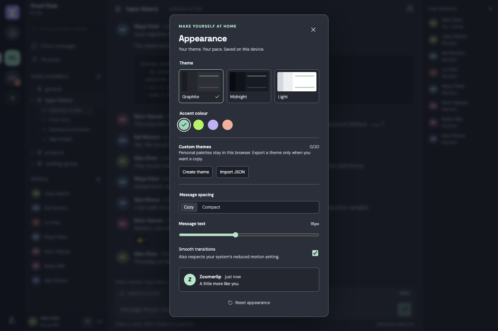

<p align="center"></p>
<h1 align="center">Zoomerlip</h1>

A [Zulip](https://github.com/zulip/zulip) client suitable for zoomers.

[](docs/screenshots/channels.png)

[](docs/screenshots/appearance.png)

[Website](https://zoomerlip.kirancodes.me) · [Source](https://github.com/kiranandcode/zoomerlip)

## Setup

Requires Node.js 22.12+.

```sh
npm ci
npm run dev
```

Open <http://127.0.0.1:5173>.

Sign in with your organisation URL, email and password, or paste an API key for SSO.

The client calls each organisation directly over HTTPS. The organisation must allow CORS requests with an Authorization header.

API keys stay in browser storage; the client discards passwords after login.

Custom palettes stay on your device.

## Build and test

```sh
npm test
npm run build       # static files in dist/
npm run preview
npm run test:ui
npm run test:themes
npm run test:safety
npm run test:scale
# Workstream A preview on port 4181:
npm run preview -- --port 4181
npm run test:messaging
```

Browser tests use Chrome and intercepted Zulip responses.

Run large builds on the MacBook Pro.

Do not use Docker or post test messages to real organisations.

## Messaging coverage

| Feature              | Behavior and availability                                                                                                                                                                                                                                                                     |
| -------------------- | --------------------------------------------------------------------------------------------------------------------------------------------------------------------------------------------------------------------------------------------------------------------------------------------- |
| Drafts               | Account/destination persistence, restore/delete, validated quotas and explicit server copy sync. Conflicts retain separate versions. Server synchronization must be enabled for the user. Local deletion does not delete a server copy; server-copy deletion is separately confirmed.         |
| Attachments          | Picker, paste/drop, organization limits, indeterminate progress, cancellation and retry. Standard multipart uploads; tus resume is not implemented. Native Android picker support is tracked by workstream C.                                                                                 |
| Composition          | Member mentions, common and organization emoji autocomplete, keyboard selection, formatting and sanitized server Markdown preview. IME and touch newlines are preserved.                                                                                                                      |
| Message actions      | Confirmed deletion for own messages/admins, server permission errors, stars, unread flags, history, permanent links and quote replies. Server policy remains authoritative.                                                                                                                   |
| Productivity         | Server scheduling (feature level 184+), snippets (297+, editing 368+), reminder creation (381+), management (399+) and notes (415+). Reminder rescheduling creates a replacement then deletes the old reminder; partial failures identify both. Timezone and failed deliveries are displayed. |
| Interactive messages | Poll/to-do drafts, participation, additions and author title edits through the experimental submessage protocol. Conservative feature level 354+ support; unsupported/invalid widgets show a fallback.                                                                                        |

Drafts never queue automatic sends on reconnection. An explicitly submitted send survives navigation; account removal or access revocation cancels pending work. Scheduled messages are delivered by the organization server. Scheduling retains the original composer draft and displays a duplicate-send warning.

Browser tests intercept every organization request. No physical-device verification is claimed. Implementation commits, API references and integration notes are in [messaging progress](docs/progress/messaging.md).

## Android

Requires Java 17 and Android SDK 35.

```sh
./scripts/build-android.sh
# android/app/build/outputs/apk/release/app-release-unsigned.apk
```

The Android app bundles the same client.

Sign release APKs on the trusted Mac and distribute them through Vibux Approver.

## Deploy

Serve `dist/` over HTTPS.

See [ops/](ops/) for Caddy configuration, release staging and rollback.
